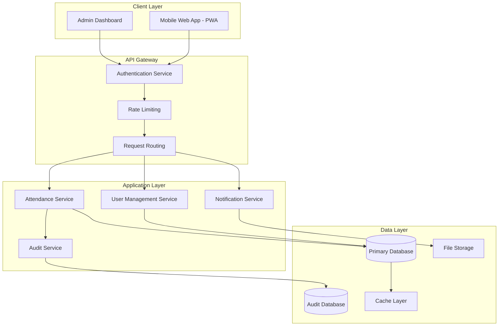

# Design Document

## Overview

The Hajiri Attendance System is designed as a modern, mobile-first web application with a RESTful backend API. The architecture prioritizes performance on mobile networks, offline capability, and role-based security. The system uses a responsive web design approach rather than native mobile apps to ensure cross-platform compatibility and easier maintenance.

### Key Design Principles

- **Mobile-First**: UI components optimized for touch interaction and small screens
- **Progressive Web App (PWA)**: Offline capability and app-like experience
- **Role-Based Security**: Strict separation of concerns between Foreman, Site Incharge, and Admin roles
- **Real-Time Calculations**: Immediate feedback for hours calculations and data validation
- **Audit-First**: Every data change is logged for compliance and dispute resolution

## Architecture

### High-Level Architecture



### Technology Stack

**Frontend:**
- React 18 with TypeScript for type safety
- Tailwind CSS for responsive design
- React Query for state management and caching
- Workbox for PWA functionality and offline support
- React Hook Form for form management

**Backend:**
- Node.js with Express.js framework
- TypeScript for type safety
- JWT for authentication
- bcrypt for password hashing
- Helmet.js for security headers

**Database:**
- PostgreSQL as primary database
- Redis for caching and session management
- Separate audit database for compliance

**Infrastructure:**
- Docker containers for deployment
- NGINX as reverse proxy
- SSL/TLS termination
- CDN for static assets

## Components and Interfaces

### Frontend Components

#### Core Components

**AttendanceSubmissionForm**
- Manages worker selection and attendance input
- Implements dial-style input for X/Y values
- Real-time hours calculation display
- Bulk operations support

**ApprovalModal**
- Displays pending attendance for review
- Inline editing capabilities
- Approval workflow management
- Audit trail display

**WorkerManagement**
- CRUD operations for worker records
- Encrypted field handling for sensitive data
- Site assignment interface

**Dashboard**
- Role-specific navigation and views
- Pending items summary
- Quick action buttons

#### Shared Components

**DialInput**
- Custom numeric input with +/- controls
- Touch-optimized for mobile devices
- Configurable min/max values
- Real-time validation

**DataTable**
- Sortable and filterable table component
- Mobile-responsive design
- Infinite scroll for large datasets
- Export functionality

### Backend Services

#### Authentication Service

```typescript
interface AuthService {
  login(credentials: LoginCredentials): Promise<AuthResponse>
  validateToken(token: string): Promise<UserContext>
  refreshToken(refreshToken: string): Promise<AuthResponse>
  logout(token: string): Promise<void>
}

interface UserContext {
  userId: string
  role: UserRole
  assignedSites: string[]
  permissions: Permission[]
}
```

#### Attendance Service

```typescript
interface AttendanceService {
  submitAttendance(submission: AttendanceSubmission): Promise<AttendanceRecord[]>
  getPendingApprovals(siteInchargeId: string): Promise<AttendanceRecord[]>
  approveAttendance(recordId: string, changes: AttendanceChanges): Promise<AttendanceRecord>
  calculateHours(xValue: number, yValue: number, siteConfig: SiteConfig): number
  getAttendanceHistory(workerId: string, dateRange: DateRange): Promise<AttendanceRecord[]>
}
```

#### User Management Service

```typescript
interface UserManagementService {
  createUser(userData: CreateUserRequest): Promise<User>
  assignUserToSite(userId: string, siteId: string): Promise<void>
  updateUserRole(userId: string, role: UserRole): Promise<User>
  deactivateUser(userId: string): Promise<void>
}
```

## Data Models

### Core Entities

#### User
```typescript
interface User {
  id: string
  name: string
  email: string
  phone: string
  role: 'FOREMAN' | 'SITE_INCHARGE' | 'ADMIN'
  assignedSites: string[]
  isActive: boolean
  createdAt: Date
  updatedAt: Date
}
```

#### Worker
```typescript
interface Worker {
  id: string
  name: string
  fatherName: string
  adharNumber?: string // encrypted
  phoneNumber?: string
  siteId: string
  isActive: boolean
  createdAt: Date
  updatedAt: Date
}
```

#### Site
```typescript
interface Site {
  id: string
  name: string
  location: string
  notes?: string
  configuration: SiteConfiguration
  createdAt: Date
  updatedAt: Date
}

interface SiteConfiguration {
  fullDayHours: number // P value, default 8
  interpretationMode: 'HOURS' | 'HALF_DAYS'
  checkpointTime: string // default "08:00"
  timezone: string
}
```

#### AttendanceRecord
```typescript
interface AttendanceRecord {
  id: string
  siteId: string
  workerId: string
  date: string // YYYY-MM-DD
  status: 'PRESENT' | 'ABSENT'
  xValue: number
  yValue: number
  calculatedHours: number
  submittedBy: string
  submittedAt: Date
  submittedToIncharge: boolean
  verified: boolean
  approvedBy?: string
  approvedAt?: Date
  originalValues?: {
    status: 'PRESENT' | 'ABSENT'
    xValue: number
    yValue: number
  }
}
```

#### AuditLog
```typescript
interface AuditLog {
  id: string
  entityType: string
  entityId: string
  action: 'CREATE' | 'UPDATE' | 'DELETE' | 'APPROVE'
  changedBy: string
  timestamp: Date
  oldValues?: Record<string, any>
  newValues?: Record<string, any>
  metadata?: Record<string, any>
}
```

### Database Schema Design

**Indexes:**
- `attendance_records(site_id, date)` for daily queries
- `attendance_records(submitted_by, submitted_at)` for foreman history
- `attendance_records(verified, site_id)` for pending approvals
- `audit_logs(entity_type, entity_id, timestamp)` for audit queries
- `workers(site_id, is_active)` for site worker lists

**Constraints:**
- Unique constraint on `(worker_id, date)` for attendance records
- Foreign key constraints with cascading rules
- Check constraints for valid enum values

## Error Handling

### Error Categories

**Validation Errors (400)**
- Invalid input data format
- Business rule violations
- Missing required fields

**Authentication Errors (401)**
- Invalid credentials
- Expired tokens
- Insufficient permissions

**Authorization Errors (403)**
- Role-based access violations
- Site assignment restrictions

**Not Found Errors (404)**
- Non-existent resources
- Deleted entities

**Conflict Errors (409)**
- Duplicate attendance submissions
- Concurrent modification conflicts

**Server Errors (500)**
- Database connection issues
- External service failures
- Unexpected system errors

### Error Response Format

```typescript
interface ErrorResponse {
  error: {
    code: string
    message: string
    details?: Record<string, any>
    timestamp: string
    requestId: string
  }
}
```

### Client-Side Error Handling

- **Network Errors**: Retry with exponential backoff
- **Validation Errors**: Inline form validation with clear messages
- **Authentication Errors**: Automatic token refresh or redirect to login
- **Offline Scenarios**: Queue operations for later sync

## Testing Strategy

### Unit Testing
- **Backend Services**: 90%+ code coverage for business logic
- **Frontend Components**: Component behavior and user interactions
- **Utility Functions**: Hours calculation, validation, formatting

### Integration Testing
- **API Endpoints**: Request/response validation
- **Database Operations**: CRUD operations and constraints
- **Authentication Flow**: Login, token validation, role enforcement

### End-to-End Testing
- **Critical User Journeys**: Attendance submission and approval workflow
- **Cross-Browser Testing**: Mobile browsers and desktop
- **Performance Testing**: Load testing for concurrent users

### Mobile Testing
- **Device Testing**: Various screen sizes and orientations
- **Network Conditions**: 2G/3G simulation
- **Touch Interactions**: Dial inputs and gesture handling
- **Offline Functionality**: PWA capabilities

### Test Data Management
- **Seed Data**: Consistent test environments
- **Data Factories**: Generate realistic test scenarios
- **Cleanup Procedures**: Isolated test execution

### Performance Testing
- **Load Testing**: 100+ concurrent users
- **Stress Testing**: Peak usage scenarios
- **Database Performance**: Query optimization validation
- **Mobile Performance**: Lighthouse audits for PWA metrics

## Security Considerations

### Data Protection
- **Encryption at Rest**: AES-256 for sensitive fields
- **Encryption in Transit**: TLS 1.3 for all communications
- **Key Management**: Secure key rotation procedures

### Authentication & Authorization
- **JWT Tokens**: Short-lived access tokens with refresh mechanism
- **Role-Based Access Control**: Strict permission enforcement
- **Session Management**: Secure session handling and timeout

### Input Validation
- **Server-Side Validation**: All inputs validated on backend
- **SQL Injection Prevention**: Parameterized queries
- **XSS Protection**: Content Security Policy headers

### Audit & Compliance
- **Comprehensive Logging**: All data changes tracked
- **Data Retention**: Configurable retention policies
- **Access Logging**: User activity monitoring